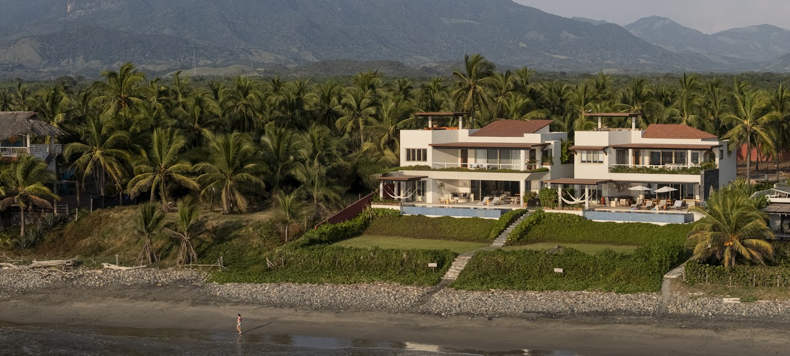

# Nix TacoSprint 2027

  

    

      
A week of Nix hacking, collaboration, and knowledge sharing on the Pacific coast of Mexico.

      

        <a href="#sponsors" class="bg-white text-primary font-bold text-xl py-4 px-8 rounded-md hover:bg-gray-100 transition duration-200 inline-block mb-4">
          Become a Sponsor
        </a>
        
Attendee applications will open soon.

      

    

    

      

        

          <h3 class="font-medium text-white text-opacity-70 uppercase text-sm tracking-wider mb-1 mt-0">When</h3>
          
June 2027

          
Exact dates to be announced

        

        

          <h3 class="font-medium text-white text-opacity-70 uppercase text-sm tracking-wider mb-1 mt-0">Where</h3>
          
<a href="https://www.google.com/maps/place/La+Saladita,+Gro.,+Mexico" class="text-white underline">La Saladita, Guerrero, Mexico</a>

          
Two beachfront villas on the Pacific coast

        

        

          <h3 class="font-medium text-white text-opacity-70 uppercase text-sm tracking-wider mb-1 mt-0">Who</h3>
          
~16 Nix developers

          
All skill levels welcome

        

      

    

  

## Location

  

    <h3 class="font-medium text-gray-500 uppercase text-sm tracking-wider mb-1">Sprint Venue</h3>
    
La Saladita, Guerrero, Mexico

    
The sprint will take place in two beachfront villas on the Pacific coast of Mexico, surrounded by jungle and steps from the sand.

  

  

    
Nearby you will find:

    <ul class="space-y-2 text-gray-600">
      <li>A world class surf break with warm water year round</li>
      <li>Beachfront taco stands and palapa restaurants serving fresh seafood</li>
      <li>Local tiendas for everyday essentials</li>
      <li>Lush tropical jungle with hiking trails</li>
      <li>The towns of Troncones and Ixtapa/Zihuatanejo a short drive away</li>
    </ul>
  

## Accommodation

  

    
Accommodation is two villas next to front beach (TBD).

    
<i>Note: Accommodation is covered by the sprint budget.</i>

  

## Food

  

    

      <h3 class="font-medium text-gray-500 uppercase text-sm tracking-wider mb-1">During the Sprint</h3>
      
We will organize catering (breakfast and lunch) during the sprint, which is paid by the sponsors. Expect tacos, fresh seafood, aguas frescas, and plenty of Mexican flavors.

      
<i>Partners are welcome to join, but food/drinks are not covered for them.</i>

    

    

      <h3 class="font-medium text-gray-500 uppercase text-sm tracking-wider mb-1">Evenings</h3>
      
There are plenty of options for dinners at local restaurants, beachfront palapas, and taco stands in the surrounding area.

    

  

## Registration

  

    
Applications for Nix TacoSprint 2027 will open soon.

    
Check back for the application form and deadline once the June dates are confirmed.

  

## Topics

  
To be determined once registration closes based on attendees interest.

## Travel

  

    
Most international flights connect through Mexico City (MEX). From there, take a domestic flight to Ixtapa/Zihuatanejo International Airport (ZIH), which is about a 1 hour flight. Several airlines operate this route daily.

    
From ZIH it is approximately a 1 hour drive north to La Saladita. You can take a taxi, arrange a private transfer, or rent a car at the airport for flexibility to explore the coast.

  

## Activities

  

    

      <h4 class="font-medium text-gray-800 mb-3">Water Activities</h4>
      <ul class="space-y-2 text-gray-600">
        <li>Surfing (La Saladita is famous for its left point break)</li>
        <li>Snorkeling</li>
        <li>Fishing</li>
        <li>Swimming</li>
      </ul>
    

    

      <h4 class="font-medium text-gray-800 mb-3">Land Activities</h4>
      <ul class="space-y-2 text-gray-600">
        <li>Yoga</li>
        <li>Jungle hikes</li>
        <li>Horseback riding on the beach</li>
        <li>Mexican cooking class</li>
      </ul>
    

    

      <h4 class="font-medium text-gray-800 mb-3">Cultural Experiences</h4>
      <ul class="space-y-2 text-gray-600">
        <li>Mezcal and tequila tasting</li>
        <li>Visit Ixtapa/Zihuatanejo</li>
        <li>Local markets</li>
        <li>Mexican gastronomy</li>
      </ul>
    

  

  

    <a href="./activities/" class="text-primary">
      Explore all activities &rarr;
    </a>
  

## 2026 Participants

  

    <a href="https://github.com/vic" class="flex flex-col items-center text-center">
      
      Victor Borja
      @vic
    </a>
    <a href="https://github.com/adeci" class="flex flex-col items-center text-center">
      
      Alex Decious
      @adeci
    </a>
    <a href="https://github.com/alurm" class="flex flex-col items-center text-center">
      
      Alan Urmancheev
      @alurm
    </a>
    <a href="https://github.com/jonringer" class="flex flex-col items-center text-center">
      
      Jon Ringer
      @jonringer
    </a>
    <a href="https://github.com/dayofdoom" class="flex flex-col items-center text-center">
      
      Jared Siegel
      @dayofdoom
    </a>
    <a href="https://github.com/marijanp" class="flex flex-col items-center text-center">
      
      Marijan Petričević
      @marijanp
    </a>
    <a href="https://github.com/ghuntley" class="flex flex-col items-center text-center">
      
      Geoffrey Huntley
      @ghuntley
    </a>
    <a href="https://github.com/domenkozar" class="flex flex-col items-center text-center">
      
      Domen Kožar
      @domenkozar
    </a>
    <a href="https://github.com/fzakaria" class="flex flex-col items-center text-center">
      
      Farid Zakaria
      @fzakaria
    </a>
  

## Sponsors

  

    <h3 class="font-medium text-gray-500 uppercase text-sm tracking-wider mb-3">Support the Event</h3>
    
We are looking for sponsors to cover expenses such as venue, catering, T shirt printing and some of the activities.

    
Please help us make this a productive event by chipping in, so we can focus on coding instead of grocery shopping and cooking.

    
Reach out to <a href="mailto:sponsors@tacosprint.org" class="text-primary">sponsors@tacosprint.org</a>.

  

  

    

      <table class="min-w-full border-collapse">
        <thead>
          <tr class="border-b border-gray-200">
            <th class="pb-3 px-4 text-left text-xs font-medium text-gray-500 uppercase tracking-wider border-r border-gray-100">Level</th>
            <th class="pb-3 px-4 text-left text-xs font-medium text-gray-500 uppercase tracking-wider border-r border-gray-100">Contribution (USD)</th>
            <th class="pb-3 px-4 text-left text-xs font-medium text-gray-500 uppercase tracking-wider">Perks</th>
          </tr>
        </thead>
        <tbody class="divide-y divide-gray-100">
          <tr>
            <td class="py-3 px-4 text-gray-900 border-r border-gray-100">Diamond</td>
            <td class="py-3 px-4 text-gray-700 border-r border-gray-100">8000</td>
            <td class="py-3 px-4 text-gray-700">Gold + Prominent logo, keynote, custom SWAG, complex procurement process.</td>
          </tr>
          <tr>
            <td class="py-3 px-4 text-gray-900 border-r border-gray-100">Gold</td>
            <td class="py-3 px-4 text-gray-700 border-r border-gray-100">4000</td>
            <td class="py-3 px-4 text-gray-700">Company + Large logo, 2 reserved seats, shoutout during dinner, SWAG, simple procurement process.</td>
          </tr>
          <tr>
            <td class="py-3 px-4 text-gray-900 border-r border-gray-100">Company</td>
            <td class="py-3 px-4 text-gray-700 border-r border-gray-100">1500</td>
            <td class="py-3 px-4 text-gray-700">Logo on Website &amp; T shirt, company name on name tag, 1 reserved seat.</td>
          </tr>
          <tr>
            <td class="py-3 px-4 text-gray-900 border-r border-gray-100">Individual</td>
            <td class="py-3 px-4 text-gray-700 border-r border-gray-100">500</td>
            <td class="py-3 px-4 text-gray-700">Link on the website.</td>
          </tr>
        </tbody>
      </table>
    

  

  

    <h3 id="sponsorship-inquiry" class="font-medium text-gray-500 uppercase text-sm tracking-wider mb-3">Become a Sponsor</h3>
    
Tell us how you would like to support TacoSprint 2027. This form opens an email draft to sponsors@tacosprint.org in your email app. Review and send it there to complete your inquiry.

    <form id="sponsorship-form" aria-labelledby="sponsorship-inquiry" aria-describedby="sponsorship-help" hidden>
      

        

          <label for="sponsor-name">Your name (required)</label>
          <input id="sponsor-name" name="name" autocomplete="name" maxlength="150" required>
        

        

          <label for="sponsor-email">Your email (required)</label>
          <input id="sponsor-email" name="email" type="email" autocomplete="email" maxlength="254" required>
        

        

          <label for="sponsor-company">Company or organization</label>
          <input id="sponsor-company" name="company" autocomplete="organization" maxlength="200">
        

        

          <label for="sponsor-level">Sponsorship level</label>
          <select id="sponsor-level" name="level">
            <option value="Let's discuss">Let's discuss</option>
            <option value="Diamond (USD 8,000)">Diamond (USD 8,000)</option>
            <option value="Gold (USD 4,000)">Gold (USD 4,000)</option>
            <option value="Company (USD 1,500)">Company (USD 1,500)</option>
            <option value="Individual (USD 500)">Individual (USD 500)</option>
          </select>
        

      

      

        <label for="sponsor-message">How would you like to help? (required)</label>
        <textarea id="sponsor-message" name="message" rows="5" maxlength="2000" required></textarea>
      

      <button type="submit" class="bg-primary text-white font-medium py-2 px-5 rounded-md hover:bg-primary-dark transition duration-200">Prepare Sponsorship Email</button>
      

    </form>
    
You can also email <a href="mailto:sponsors@tacosprint.org?subject=TacoSprint%202027%20sponsorship" class="text-primary">sponsors@tacosprint.org</a> directly.

  

## Organizers

  

    

      
      

        <h4 class="font-medium text-gray-800 mb-1">Domen Kozar</h4>
        
Long time contributor to Nix, author of <a href="https://devenv.sh">devenv</a> and <a href="https://cachix.org/">Cachix</a>.

        <a href="https://github.com/domenkozar" class="text-primary text-sm">
          @domenkozar
        </a>
      

    

    

      
      

        <h4 class="font-medium text-gray-800 mb-1">Farid Zakaria</h4>
        
Build systems and Nix expert, <a href="https://fzakaria.com">fzakaria.com</a>.

        <a href="https://github.com/fzakaria" class="text-primary text-sm">
          @fzakaria
        </a>
      

    

  

